


 

  

  

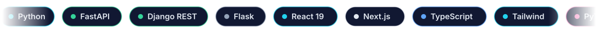

 


I'm a final-year **MCA student at Jamia Hamdard University, New Delhi**, with a **BCA from Integral University, Lucknow**. I build full-stack, AI-powered applications end to end: scraping and data pipelines, backend APIs, LLM-driven agents and polished frontends. I care about shipping things that work in production, not just demos.

  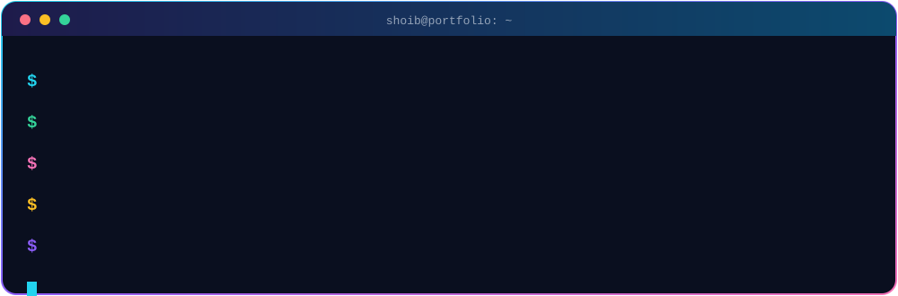

 

<table>
  <tr>
    <td>🎯 <b>Looking for</b></td>
    <td>SDE-1 · Software Engineer · AI/ML Developer roles at product companies and startups</td>
  </tr>
  <tr>
    <td>🤖 <b>Working with</b></td>
    <td>LangGraph, LangChain, Claude Agent SDK, Gemini API, FastAPI, React 19, PyTorch</td>
  </tr>
  <tr>
    <td>🔭 <b>Focus areas</b></td>
    <td>Agentic AI workflows · Computer vision · Explainable ML · Offline-first apps</td>
  </tr>
  <tr>
    <td>📄 <b>Published</b></td>
    <td>Sole author, IJSAT Vol. 16, Issue 4 (Nov 2025) · <a href="https://doi.org/10.71097/IJSAT.v16.i4.9262"><i>IU CA Cross Platform App</i></a></td>
  </tr>
  <tr>
    <td>🏆 <b>Community</b></td>
    <td>Campus Ambassador, Hack2skill Google Build with AI Challenge 2026</td>
  </tr>
  <tr>
    <td>✍️ <b>Off the keyboard</b></td>
    <td>I write Urdu shayari</td>
  </tr>
</table>

 


  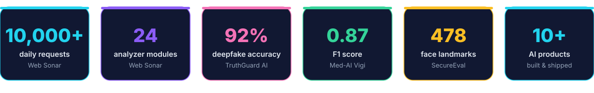

 


<table>
  <tr>
    <td width="170" valign="top"><b>Freelance Software Engineer</b> RuralHealthAI</td>
    <td>
      Built an <b>offline-first rural health screening platform</b> for real low-connectivity use: Django REST Framework APIs, a React 18 + Vite frontend with IndexedDB offline sync, Gemini Pro for screening logic and Firebase services.
    </td>
  </tr>
</table>

 


<table>
  <tr>
    <td align="center" width="170"><b>⚙️ Languages &amp; Backend</b></td>
    <td>
      
    </td>
  </tr>
  <tr>
    <td align="center"><b>🎨 Frontend</b></td>
    <td>
      
    </td>
  </tr>
  <tr>
    <td align="center"><b>🧠 AI / ML</b></td>
    <td>
       
      
      
      
      
      
      
    </td>
  </tr>
  <tr>
    <td align="center"><b>🔌 Data &amp; Automation</b></td>
    <td>
      
      
      
      
    </td>
  </tr>
  <tr>
    <td align="center"><b>☁️ Cloud &amp; DevOps</b></td>
    <td>
       
      
      
    </td>
  </tr>
</table>

 


<table>
  <tr>
    <td width="50%" valign="top">
      <h3>🏥 RuralHealthAI</h3>
      <b>FREELANCE BUILD · OFFLINE-FIRST HEALTH SCREENING</b>
      
Built for low-connectivity regions. Django REST Framework backend, React 18 + Vite frontend with IndexedDB offline sync, Gemini Pro for screening logic and Firebase services.

      
      
      
      
      
    </td>
    <td width="50%" valign="top">
      <h3>🔎 Web Sonar</h3>
      <b>MCA CAPSTONE · AI WEBSITE ANALYSIS PLATFORM</b>
      
Deep-analysis engine for SEO, performance, security and content quality. 24 analyzer modules across 30+ panels, handling 10,000+ requests daily in production.

      
      
      
      
    </td>
  </tr>
  <tr>
    <td width="50%" valign="top">
      <h3>♿ Curbcut</h3>
      <b>HACKATHON · OPEN SOURCE · AGENTIC WCAG REMEDIATION</b>
      
An agentic workflow that repairs WCAG accessibility defects in HTML pages and verifies its own work against harm gates. Corpus, harness, scoring code and agent trajectories are all committed.

      
      
      
      
      
      
    </td>
    <td width="50%" valign="top">
      <h3>🎓 SecureEval</h3>
      <b>LIVE AI EXAM PROCTORING · DEPLOYED AT INTEGRAL UNIVERSITY</b>
      
Real-time integrity tracking using 478-point facial landmark detection (MediaPipe Face Mesh) with Gemini 1.5 Flash for anomaly reasoning.

      
      
      
      
    </td>
  </tr>
  <tr>
    <td width="50%" valign="top">
      <h3>🕵️ TruthGuard AI</h3>
      <b>CNN-BASED DEEPFAKE DETECTOR</b>
      
PyTorch + OpenCV vision model reaching <b>92% accuracy</b> on FaceForensics++, served through a FastAPI inference endpoint.

      
      
      
    </td>
    <td width="50%" valign="top">
      <h3>💳 Solvency AI</h3>
      <b>IDBI HACKATHON · TEAM NEURON</b>
      
Dual-engine credit underwriting: XGBoost scoring plus Gemini 2.5 Pro reasoning, with SHAP explainability and Firebase-based risk alerting.

      
      
      
      
    </td>
  </tr>
  <tr>
    <td width="50%" valign="top">
      <h3>💊 Med-AI Vigi</h3>
      <b>ADVERSE DRUG REACTION PREDICTION</b>
      
XGBoost / Random Forest models with SHAP explainability, reaching an <b>F1 score of 0.87</b>.

      
      
      
    </td>
    <td width="50%" valign="top">
      <h3>🎯 HireSight AI</h3>
      <b>CANDIDATE RANKING · REDROB HACKATHON</b>
      
Ranks resumes against job descriptions using TF-IDF cosine similarity with custom heuristics for an explainable match score. FastAPI backend, React 19 + Vite + Tailwind frontend.

      
      
      
      
    </td>
  </tr>
  <tr>
    <td width="50%" valign="top">
      <h3>🛒 PriceRadar</h3>
      <b>PRICE COMPARISON FOR INDIAN E-COMMERCE</b>
      
Tracks and compares prices across platforms using Playwright scraping and Gemini for product matching, served via FastAPI + React.

      
      
      
    </td>
    <td width="50%" valign="top">
      <h3>🗄️ SQL Analyzer</h3>
      <b>NATURAL-LANGUAGE SQL ANALYSIS</b>
      
Query and analyze databases in plain English, built with React 19 + FastAPI + Gemini 2.5 Flash + Firebase.

      
      
      
    </td>
  </tr>
</table>

 


<table>
  <tr>
    <td valign="top">
      <h3>📱 IU CA Cross Platform App</h3>
      <b>PEER-REVIEWED · IJSAT VOL. 16, ISSUE 4 · NOV 2025</b>
      
Sole-authored paper on a cross-platform academic department application built with Flutter/Dart. <a href="https://github.com/shoibahmad/IU-CA">Source code</a> · <a href="https://doi.org/10.71097/IJSAT.v16.i4.9262">Read the paper (DOI 10.71097/IJSAT.v16.i4.9262)</a>

      
      
      
    </td>
  </tr>
</table>

 


<table>
  <tr>
    <td width="130"><b>2024 – 2026</b></td>
    <td><b>Master of Computer Applications (MCA)</b> Jamia Hamdard University, New Delhi · CGPI 8.26</td>
  </tr>
  <tr>
    <td><b>2021 – 2024</b></td>
    <td><b>Bachelor of Computer Applications (BCA)</b> Integral University, Lucknow · CGPA 9.10</td>
  </tr>
</table>

 


<table>
  <tr>
    <td>📜 <b>Introduction to Agents</b></td>
    <td>Mercor · Sep 2026 · <a href="https://work.mercor.com/learn/verify/MRC-2026-XC5JG862">Verify credential</a></td>
  </tr>
  <tr>
    <td>📜 <b>Generative AI Foundations</b></td>
    <td>upGrad</td>
  </tr>
  <tr>
    <td>🏆 <b>Campus Ambassador</b></td>
    <td>Hack2skill · Google Build with AI Challenge 2026</td>
  </tr>
  <tr>
    <td>📄 <b>Published Paper</b></td>
    <td>IJSAT Vol. 16, Issue 4 (Nov 2025) · <a href="https://doi.org/10.71097/IJSAT.v16.i4.9262">DOI 10.71097/IJSAT.v16.i4.9262</a></td>
  </tr>
</table>

 


  
  

   

  

 


Open to SDE-1 and AI/ML Developer roles. If you're building something interesting, I'd love to hear about it.

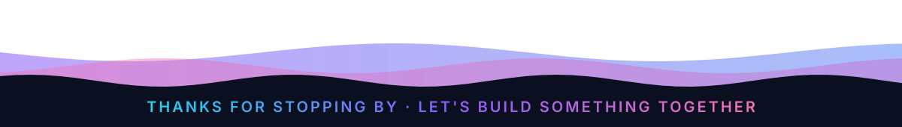

